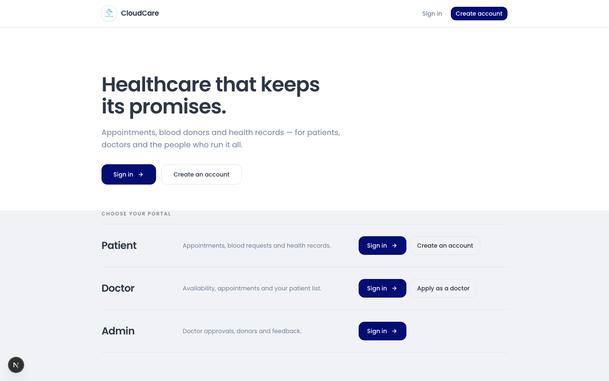
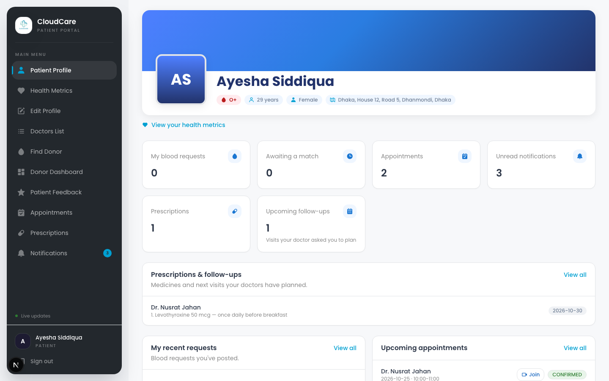
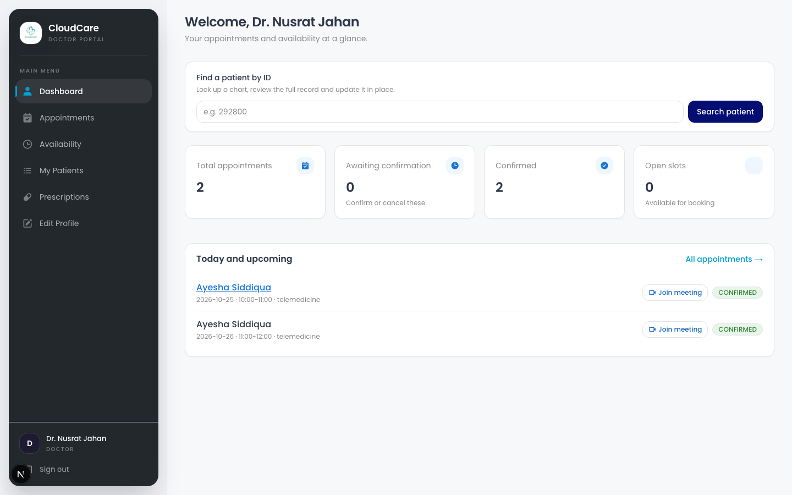
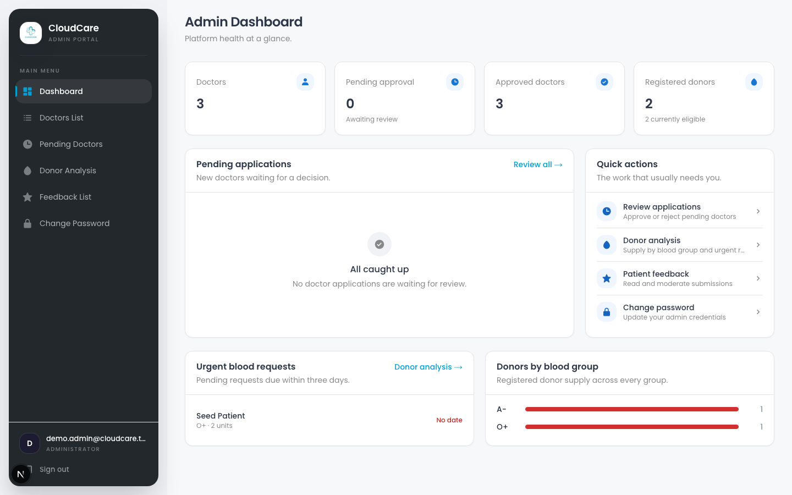
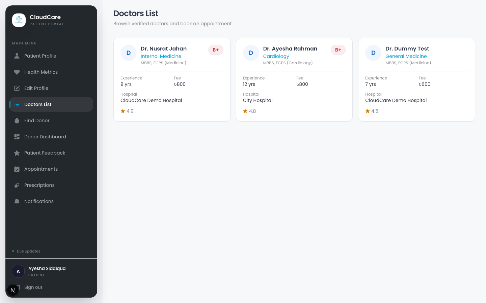

<div align="center">


# CloudCare

**Healthcare that keeps its promises.**

Appointments, telemedicine, patient charts, prescriptions and a live blood
donation network — one platform, three portals, one afternoon to demo.

[](https://nextjs.org/)
[](https://react.dev/)
[](https://www.typescriptlang.org/)
[](https://spring.io/projects/spring-boot)
[](https://openjdk.org/)
[](https://www.postgresql.org/)
[](LICENSE)

[Live demo accounts](#demo-accounts) · [Features](#feature-reference) ·
[Architecture](#architecture) · [Quick start](#quick-start) ·
[Security](#authentication--security)

</div>

---

## What is this

CloudCare is a full-stack clinic platform covering the entire working day of
a small practice: patients register, browse doctors and book appointments;
doctors confirm visits, write prescriptions and update charts; admins approve
doctors and watch the blood supply. Everything is wired end to end — not a
mockup. Booking an appointment writes to Postgres, pushes a live WebSocket
notification to the doctor, and the doctor's confirmation generates a real
Jitsi video room.

**Next.js 16** (React 19, App Router, Server Actions) talks to a
**Spring Boot 3.4** JSON API over a same-origin proxy, backed by
**PostgreSQL** and **Supabase Storage**, with **STOMP/WebSocket** for
realtime notifications and **Jitsi Meet** for video consultations.

### ✨ Highlights

- **Three independently secured portals** — patient, doctor and admin each
  get their own Spring Security filter chain; a doctor's session gets a 403
  on a patient endpoint, enforced by the framework, not by convention.
- **Real-time, not polling.** A doctor saving a chart or writing a
  prescription pushes a signed, authenticated WebSocket notification straight
  to that patient's browser.
- **Hardened auth** — single-use, hashed, 30-minute password-reset tokens
  delivered only by email; signed short-lived WebSocket tickets instead of a
  client-asserted identity; an origin-check CSRF filter on every mutation.
  See [Authentication & security](#authentication--security).
- **Zero-config demo.** One backend start seeds three working accounts with
  real appointments, availability and prescriptions — no manual setup.
- **Documented, not idealised.** The [known gaps](#known-gaps) section lists
  exactly what's unfinished and why, instead of pretending the migration is done.

---

## 📸 Screenshots

<table>
<tr>
<td width="50%">

**Landing — pick your portal**


</td>
<td width="50%">

**Patient dashboard**


</td>
</tr>
<tr>
<td width="50%">

**Doctor dashboard**


</td>
<td width="50%">

**Admin dashboard**


</td>
</tr>
</table>

<details>
<summary>Doctor directory (patient view)</summary>

</details>

---

## 🔑 Demo accounts

Seeded on every backend start (idempotent — restarting never duplicates
data), with a one-click button per role on the login page. No email or OTP
setup required.

| Role | Email | Password |
| --- | --- | --- |
| Patient | `demo.patient@cloudcare.test` | `Demo@123` |
| Doctor | `demo.doctor@cloudcare.test` | `Demo@123` |
| Admin | `demo.admin@cloudcare.test` | `admin123` |

The demo doctor is pre-loaded with confirmed telemedicine appointments and
availability slots, so the booking and video flows work immediately.

---

## 🧰 Tech stack

<table>
<tr><td valign="top" width="50%">

**Frontend**

| Technology | Role |
| --- | --- |
| **Next.js 16** (App Router) | Routing, Server Components, streaming |
| **React 19** | UI runtime, Server Actions |
| **TypeScript** | End-to-end type safety |
| **Tailwind CSS 4** | Design system driven by CSS custom properties |
| **Server Actions** | Authenticated form mutations without client JS |
| **SockJS + STOMP** | Live notification channel |
| **`@splinetool/runtime`** | Optional 3D scene on the landing hero (lazy-loaded) |

</td><td valign="top" width="50%">

**Backend**

| Technology | Role |
| --- | --- |
| **Spring Boot 3.4 / Java 17** | REST API, scheduling, realtime |
| **Spring Security 6** | Three role-scoped filter chains |
| **Spring Data JPA / Hibernate** | Persistence, `ddl-auto=update` |
| **Spring WebSocket (STOMP)** | Broker-backed user messaging |
| **Brevo REST API** | Transactional email (optional) |
| **PostgreSQL** | Primary datastore (via JDBC) |
| **Supabase Storage** | Profile photos, certificates, reports |
| **Lombok** | Boilerplate reduction |
| **Jakarta Validation** | Request validation |

</td></tr>
</table>

---

## 🏗 Architecture

```
┌──────────────┐   Server Components / Server Actions   ┌──────────────┐
│   Browser    │ ─────────────────────────────────────► │  Next.js 16  │
└──────────────┘   ◄───────────────────────────────────── │  :3000       │
                        HTML + RSC payload                └──────┬───────┘
                                                               │
                     same-origin rewrite /api/spring/*        │
                     (session cookie stays first-party)       │
                                                               ▼
┌──────────────┐   JPA / Security / WebSocket        ┌──────────────┐
│  PostgreSQL  │ ◄──────────────────────────────────► │ Spring Boot  │
│  Supabase    │                                      │   :8080      │
│   Storage    │                                      └──────────────┘
└──────────────┘
```

**Why a same-origin proxy.** The browser only ever talks to `:3000`. Next.js
proxies `/api/spring/*` to Spring and forwards the `JSESSIONID` cookie, which
means the session is first-party, CORS never applies, and `SameSite=Lax`
suffices — no `SameSite=None; Secure` gymnastics.

**Authorization model.** Three `SecurityFilterChain`s partition the API by
path prefix: `/patient/**`, `/doctor/**`, `/admin/**`. A session authenticated
as a patient cannot reach a doctor endpoint, enforced by Spring Security
rather than by route convention.

---

## 📋 Feature reference

### Patient portal

- **Dashboard** — profile card, health metrics summary, and live counts for
  blood requests, pending matches, appointments, prescriptions, follow-ups and
  unread notifications
- **Health metrics** — vitals and derived ranges
- **Edit profile** — photo upload plus identity, body measurements, address and
  family/emergency contacts, with a sticky *unsaved changes* bar
- **Doctor directory & booking** — browse verified doctors, view a profile, see
  live availability slots, book an appointment
- **Appointments** — upcoming and past, with a **Join** button on confirmed
  telemedicine visits
- **Prescriptions** — every medicine, instruction and follow-up date, with
  *upcoming / due today / overdue* status
- **Notifications** — categorised timeline grouped by day, with unread markers,
  relative timestamps and a live toast the moment one arrives
- **Feedback** — submit ratings and comments
- **Blood requests** — post a request with blood group and location

### Doctor portal

- **Dashboard** — appointment and availability statistics
- **Patient lookup** — find **any patient by ID** from the dashboard or the
  My Patients page
- **Patient chart** — full editable record; saving broadcasts a live
  notification to that patient
- **Prescription maker** — enter a patient ID, review their summary and history,
  write medicines and instructions, set the next follow-up date
- **Appointments** — confirm or cancel; confirming a telemedicine appointment
  generates the meeting link
- **Availability** — publish and remove consultation slots
- **My Patients** — searchable patient list
- **Profile** — edit the public doctor profile
- **Apply** — doctor signup with certificate upload

### Admin portal

- **Dashboard** — platform overview
- **Doctor approvals** — review pending applications, approve or reject
- **Doctors list** — browse all registered clinicians
- **Donor analysis** — donor totals, trends, and urgent outstanding requests
- **Feedback list** — review and delete patient feedback
- **Change password**

### Blood donation network

- Donor self-registration with blood group and location
- Requests posted with units required, blood group, district and thana
- **Matching** by blood group *and* geographic area (`findMatchingDonors`)
- Eligibility checking before a donor is accepted
- Match notification to matched donors
- Admin analytics: donor totals, trends, urgent requests

### Telemedicine

Confirmed telemedicine appointments carry a **Jitsi Meet** link of the form
`https://meet.jit.si/{roomName}`, generated at confirmation time and stored on
the appointment. The **Join** button opens it in a new tab — the room is real
and requires no account.

> This is Jitsi, **not** Google Meet. See [known gaps](#known-gaps).

### Email

A single `EmailService` posts to the **Brevo** API (`/v3/smtp/email`) for
appointment, doctor-account, blood-donor and password-reset emails. Without
`BREVO_API_KEY` the app still runs: every send is skipped and logged (reset
links print to the console) so the whole app works offline in local dev.

---

## 🔐 Authentication & security

- Three separate login entry points (`/login`, `/doctor/login`, `/admin/login`),
  each backed by its own `SecurityFilterChain`; a session for one role gets a
  403 on another role's API
- One-click demo sign-in for all roles
- BCrypt password hashing; session-backed auth with `HttpOnly`, `SameSite=Lax`
  cookies (`Secure` behind HTTPS)
- Admin account bootstrapped from environment variables on first start

**Password reset by emailed link** (`security/PasswordResetService`):

- 256-bit random token, **only its SHA-256 hash is stored**, valid 30 minutes,
  single use, and never returned in an HTTP response
- `forgot` answers the same way whether or not the account exists, so emails
  can't be enumerated, and issues at most one link per minute per account
- New passwords need at least 8 characters; a reset does not sign you in
- With no mail provider configured (local dev), the link is printed to the
  backend console instead of being emailed

**CSRF** (`security/OriginCheckFilter`): every POST/PUT/PATCH/DELETE whose
`Origin` (or `Referer`) is not a configured CloudCare origin is rejected with
403 before it reaches Spring Security. Server-to-server calls from Next.js send
no browser origin and pass. Together with `SameSite=Lax` cookies and Next.js'
own Origin check on Server Actions, this replaces Spring's token-based CSRF,
which would not add protection when the frontend calls the API server-side.
CORS and the WebSocket handshake use the same allow-list
(`CLOUDCARE_ALLOWED_ORIGINS`).

**WebSocket authentication** is covered under
[Realtime & notifications](#realtime--notifications).

---

## ⚡ Realtime & notifications

This is a genuinely working end-to-end path, not a stub:

1. Before every (re)connect, `LiveNotifications.tsx` calls a Server Action that
   fetches `GET /api/ws-ticket` with the user's session. Spring returns a
   **signed ticket** (HMAC-SHA256 over the user's email and a 2-minute expiry).
2. The browser opens SockJS to `/ws` and sends the ticket in the STOMP
   `CONNECT` frame. `WebSocketConfig` verifies the signature and expiry and
   binds the connection to that email. A client never gets to claim its own
   identity, so it can't listen to someone else's queue.
3. `NotificationService.sendToSpecific(email, …)` calls
   `convertAndSendToUser(email, "/queue/notifications", …)`
4. The browser subscribes to `/user/queue/notifications` and shows a toast

The interceptor also refuses subscriptions to raw `/queue/**` destinations and
any client `SEND`, since the server is the only publisher. That stops a client
broadcasting fake notifications to a topic.

Notifications fire from three real call sites, all verified in the source:
`DoctorPatientRecordController` (doctor saves a patient chart),
`DoctorApiController` (doctor writes a prescription note), and
`PrescriptionService` (the reminder job).

**Prescription reminders** run on an hourly cron plus once at
`ApplicationReadyEvent`. The job is idempotent — each prescription stores flags
for the "coming up" and "due" notifications — so restarts do not duplicate them.

Broadcast failures are caught, so a dead socket can never roll back a database
write.

---

## 🔄 Full-stack request walkthrough

**"Book an appointment"** — one user action, every layer involved:

1. **Browser** — the patient picks a doctor and a slot on a Next.js page
2. **Server Action** — Next.js receives the form, forwards the session cookie to
   Spring via `springFetch`
3. **Spring Security** — the `/patient/**` filter chain validates the session and
   resolves the patient from the `SecurityContext`
4. **Service layer** — validates the slot is free, then persists the
   `Appointment` and flips the availability slot
5. **JPA/Hibernate** — writes to PostgreSQL inside a transaction
6. **WebSocket** — a notification is pushed to the doctor's private queue
7. **Response** — Next.js revalidates and the patient sees the new appointment

The same path, reversed, drives confirm/cancel: a doctor's confirmation writes
the meeting link and notifies the patient in real time.

---

## 🗃 Data model

Principal entities and their relationships:

- **`Patient`** — profile, vitals, address, emergency contact; owns blood
  requests and donations
- **`Doctor`** — profile, specialty, BMDC registration; owns availability slots
  and appointments
- **`Admin`** — operator account
- **`Appointment`** — links a patient and doctor to a slot, with status and an
  optional telemedicine link
- **`Availability`** — a doctor's bookable consultation slot
- **`Prescription`** — medicines, instructions and a follow-up date, linked to a
  patient and doctor, with reminder flags
- **`BloodRequest`** — units required, blood group, location, urgency
- **`Donor`** — blood group and location used for matching
- **`HealthRecord`** — vitals and metrics
- **`Feedback`** — ratings and comments
- **`Notification`** — per-user messages

Schema is created and kept in sync by Hibernate
(`SPRING_JPA_HIBERNATE_DDL_AUTO=update`), so there is no separate migration to
run for a fresh database.

---

## 🚀 Quick start

### Prerequisites

- Java 17
- Maven (the repo also ships `./mvnw`)
- Node.js 20+
- A Supabase project — or a local PostgreSQL instance if you are offline

### 1. Configure

```bash
cp backend/.env.example backend/.env
```

Only five values are required; everything else has a default in
`backend/src/main/resources/application.properties`.

```dotenv
SPRING_DATASOURCE_URL=jdbc:postgresql://localhost:5432/cloudcare
SPRING_DATASOURCE_USERNAME=<user>
SPRING_DATASOURCE_PASSWORD=<password>   # omit if local Postgres trusts the user
ADMIN_EMAIL=demo.admin@cloudcare.test
ADMIN_PASSWORD=<choose one>
```

Optional extras, documented in `backend/.env.example`:

- **File uploads**: `SUPABASE_URL`, `SUPABASE_SERVICE_ROLE_KEY`, `SUPABASE_STORAGE_BUCKET`
- **Email**: `BREVO_API_KEY`, `BREVO_SENDER_EMAIL`, `BREVO_SENDER_NAME`
- **Deployment**: `CLOUDCARE_ALLOWED_ORIGINS`, `CLOUDCARE_FRONTEND_URL`, `SESSION_COOKIE_SECURE`
- **Supabase Postgres** instead of local: `.env.example` shows the direct and pooler URL forms

The frontend needs no env file. It talks to `http://localhost:8080` unless
`SPRING_API_URL` is set (see `frontend/.env.example`).

### 2. Start the backend

```bash
cd backend
./run-backend.sh          # loads .env, selects JDK 17, starts :8080
```

> On macOS `./mvnw` alone may not locate a JDK; `run-backend.sh` handles it.

### 3. Start the frontend

```bash
cd frontend
npm install
npm run dev               # http://localhost:3000
```

---

## ✅ Verification

```bash
# Backend: unit tests for the security pieces + MockMvc integration tests
# (needs the database from .env)
cd backend
./run-backend.sh test

# Frontend typecheck + lint + production build
cd frontend
npx tsc --noEmit
npm run lint
npm run build
```

---

## 📁 Project structure

```text
CLOUDCARE/
├── backend/
│   ├── src/main/java/com/example/cloud/care/
│   │   ├── config/              Security chains, WebSocket, async, admin bootstrap, demo seeder
│   │   ├── controller/
│   │   │   ├── patient/         Patient JSON API: profile, donors, blood requests, feedback
│   │   │   ├── doctor/          Doctor JSON API: appointments, availability, patient records
│   │   │   ├── admin/           Admin JSON API: doctor approvals, donors, feedback
│   │   │   └── common/          /, /api/me, /api/ws-ticket, locations
│   │   ├── dto/                 Response DTOs
│   │   ├── model/                JPA entities
│   │   ├── repository/          Spring Data repositories
│   │   ├── security/             Password reset tokens, WebSocket tickets, CSRF origin check
│   │   └── service/              Business logic, email, storage, scheduling
│   ├── src/main/resources/
│   │   ├── application.properties   Defaults; secrets come from env
│   │   └── static/data/             bd_locations.json, loaded programmatically
│   ├── src/test/java/            Security unit tests + MockMvc integration tests
│   ├── run-backend.sh           Loads .env, picks JDK 17, runs Maven
│   ├── Dockerfile               Backend image
│   └── .env.example
├── frontend/src/
│   ├── app/
│   │   ├── (auth)/          /login, /register, /forgot-password, /reset-password
│   │   ├── (patient)/       Patient portal (/dashboard, /appointments, ...)
│   │   ├── doctor/          Doctor portal
│   │   ├── admin/           Admin portal
│   │   └── api/             Route handlers (logout relay)
│   ├── components/          Layout, auth, UI primitives, feature components
│   └── lib/                 API clients, auth helpers, shared types
└── docs/screenshots/        README screenshots
```

`(auth)` and `(patient)` are Next.js route groups: they organise the folders
without changing any URL.

The frontend ships **36 pages**: 1 landing page, ~14 patient, 11 doctor and
7 admin. Every one of them is served by Spring's JSON APIs under
`/patient/api/*`, `/doctor/api/*` and `/admin/api/*` — there is no
server-rendered view layer behind it; the handful of Spring MVC endpoints
that still exist (`/patient/register`, `/doctor/signup/request`, password
reset) return JSON too.

---

## 🚧 Known gaps

Documented so nobody else re-litigates them:

- **No AI / LLM integration.** There is no model dependency, chat endpoint or
  quiz. The orphaned quiz model and the unused PDF library have been removed.
- **Telemedicine is Jitsi, not Google Meet.** Links are `meet.jit.si`.
- **Cloudinary was removed.** Uploads go to Supabase Storage via
  `SupabaseStorageService`, which fails with a clear message if unconfigured.
- **Still to do before a real deployment:** rate-limit login and reset
  requests per IP (reset is already limited per account), and add an audit log
  for admin actions.

---

## 📝 Notes for reviewers

- **Demo data is seeded on every backend start** and is idempotent — restarting
  will not duplicate appointments, slots or reminders.
- **Meeting links are real Jitsi rooms**, generated at confirmation time.
- **The WebSocket path is live end to end**, authenticated by a short-lived
  signed ticket rather than a client-claimed email — see
  [Realtime & notifications](#realtime--notifications) for the exact handshake.
- **Most JSON endpoints build their response as an explicit `Map`** rather than
  returning a JPA entity, which avoids lazy-init failures and accidental field
  exposure. This is not uniform: some controllers still return entities, and
  `dto/` currently holds only `PrescriptionDto`. Treat the `Map` approach as the
  convention rather than the rule.
- **The landing-page Spline scene is optional and fails silently.** Its runtime
  is ~2.8MB and is only fetched on viewports ≥1024px; if the scene 403s, nothing
  renders and repeat visits skip the request for the rest of the session.
- **If you add a backend endpoint, add it under `/api/`.** The three filter
  chains scope authorization by path prefix, so a new endpoint has to live under
  `/patient/api`, `/doctor/api` or `/admin/api` to inherit the right rules.
  Returning a JPA entity works but the `Map`-per-endpoint convention in
  `DoctorApiController` and `PatientApiController` is the better pattern to copy.

---

<div align="center">

Built by [Farhan Labib](https://github.com/farhanlabibahan) · MIT licensed

</div>
